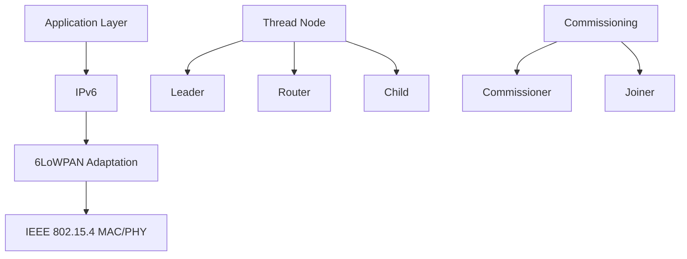
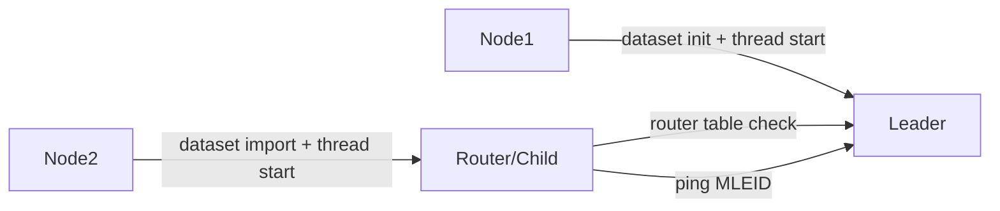
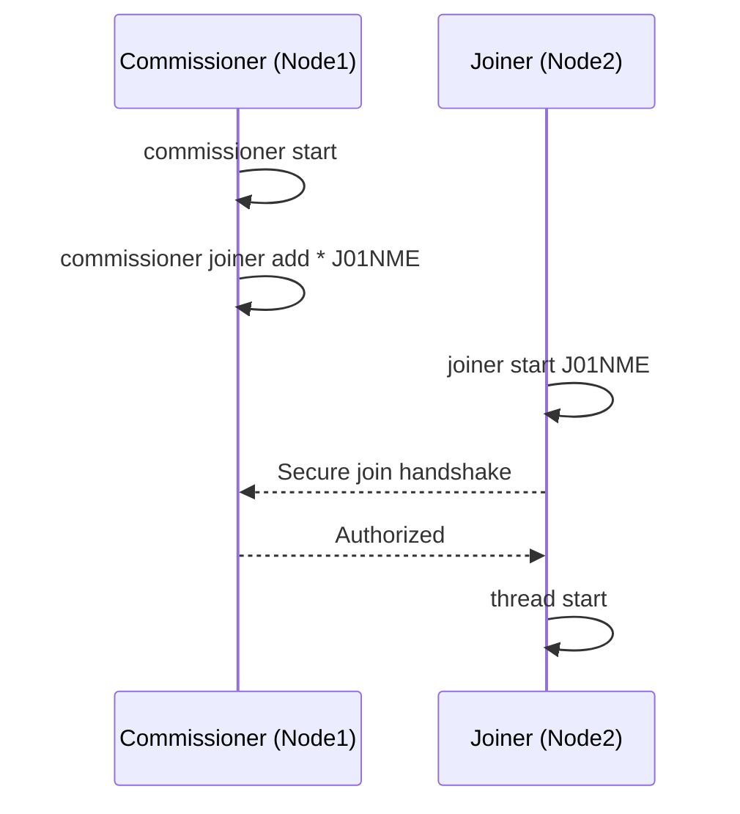
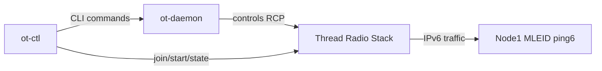
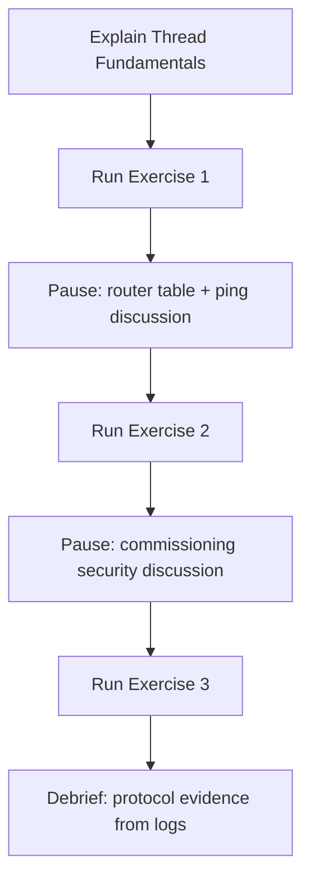

# OpenThread Thread Lab for Teaching

This repository is designed for classroom use: you can use it both to **teach Thread protocol concepts** and to **run a reproducible hands-on lab** with automated checks.

It includes:
- a complete automated lab runner (`run_thread_lab.sh` + `thread_lab_autorun.exp`)
- a step-by-step workflow aligned with typical Thread learning goals
- practical checkpoints to verify network formation, commissioning, and IPv6 connectivity

---

## 1) Learning Objectives

By the end of this lab, students should be able to:
- explain what Thread is and why it is used in low-power IoT networks
- identify Thread roles (`leader`, `router`, `child`, Commissioner, Joiner)
- create a basic Thread network and verify node attachment
- perform commissioning and understand secure node admission
- use `ot-daemon` and `ot-ctl` for RCP/NCP-style management
- validate IPv6 connectivity in a Thread network

---

## 2) Thread Protocol Theory (Short Teaching Notes)

### 2.1 What Thread Is

Thread is an IPv6-based mesh networking protocol built for low-power and low-data-rate IoT devices.  
It runs over IEEE 802.15.4 and uses 6LoWPAN adaptation so constrained devices can communicate with IPv6 networks.

### 2.2 Why Thread Matters

- **Low power**: suitable for battery-powered devices
- **Mesh topology**: multi-hop routing improves coverage and resilience
- **Self-healing**: routes can be recalculated when topology changes
- **IP-native**: devices are addressable with IPv6, easing cloud/home integration
- **Secure commissioning**: explicit procedure to authorize new devices

### 2.3 Main Roles in This Lab

- **Leader**: coordinates network parameters and router table management
- **Router**: forwards traffic and extends mesh connectivity
- **Child**: attached node (often lower-duty operation than router)
- **Commissioner**: authorizes Joiners into the network
- **Joiner**: device requesting secure admission

### 2.4 Addressing Concepts You Will See

- **Mesh-Local IPv6**: Thread-internal addressing domain
- **ML-EID / MLEID**: endpoint identifier used for end-to-end connectivity tests
- **RLOC16**: short routing locator visible in router tables

### 2.5 Visual Model (Mermaid)



This diagram helps students connect protocol stack layers with runtime node roles.

---

## 2.6 Thread in Simple Words (Student-Friendly)

If you need a very simple explanation in class:

- A Thread network is like a **team of smart devices** that can pass messages to each other.
- One device becomes **Leader** (organizes the team).
- Some devices become **Router** (help carry messages).
- Some devices stay **Child** (connected, but less routing work).
- New devices cannot enter directly: they must be approved by a **Commissioner**.
- The new device asks permission as **Joiner**.
- Once approved, the Joiner becomes part of the network and can communicate with IPv6.

Think of it like a school:
- Leader = class coordinator
- Routers = students that relay instructions to others
- Child = student connected to the class but not relaying
- Commissioner = teacher checking who can enter
- Joiner = new student asking to join

---

## 3) Lab Structure

The automated flow runs three exercises:

### Exercise 1 - Build and Validate a 2-Node Thread Network

What happens:
- Node1 initializes dataset, starts Thread, becomes `leader`
- Node2 imports key/panid, starts Thread, attaches as `child/router`
- Router table is checked
- Node2 pings Node1 MLEID
- Failover behavior is observed after stopping Thread on Node1

What students should discuss:
- `child` vs `router` transition timing
- why ping works even as topology evolves
- meaning of `RLOC16` and router table entries



### Exercise 2 - Commissioning (Commissioner + Joiner)

What happens:
- Node1 starts a new network and becomes Commissioner
- Node2 joins using Joiner PSKd (`J01NME`)
- Join success is verified
- Node2 is validated as attached (`child` or `router`)

What students should discuss:
- security purpose of commissioning
- difference between open attachment and authorized join



### Exercise 3 - `ot-daemon` + `ot-ctl` (RCP-style workflow)

What happens:
- Node1 forms another network
- `ot-daemon` is started for RCP workflow
- `ot-ctl` is used to join and start Thread
- state is validated (`router`/`child`, with fallback logic)
- IPv6 `ping6` connectivity is verified from shell
- optional `tcpdump` check is attempted when available

What students should discuss:
- CLI-on-node vs daemon+control-client management model
- operational troubleshooting when node state remains `detached`



---

## 3.1 Step-by-Step Lab Walkthrough (Simplified)

This section is meant to be read live with students.

### Step 0 - Start the automation

Run:

```bash
./run_thread_lab.sh
```

What to explain:
- Docker container is prepared
- all lab commands are executed automatically
- logs are checkpoints, not random text

### Step 1 - Build first Thread network

What happens:
- Node1 creates dataset and starts Thread
- Node1 becomes `leader`
- Node2 receives same network parameters and starts Thread

What to show in output:
- `Node1 is leader`
- `Node2 is router` (or first `child`, then `router`)

### Step 2 - Verify communication

What happens:
- script checks router table
- Node2 pings Node1 MLEID

What to show in output:
- `Router table contains Node2 RLOC16`
- `Ping Node2->Node1 succeeded`

Teaching message:
- "network formed" is not enough, we also need packet-level proof

### Step 3 - Commissioning

What happens:
- Node1 starts Commissioner role
- Node2 starts Joiner with PSKd `J01NME`
- Join is validated

What to show in output:
- `Join success`
- `Node2 joined and is child` or `Node2 joined and is router`

Teaching message:
- secure admission is a core Thread feature

### Step 4 - Daemon-based control (`ot-daemon` + `ot-ctl`)

What happens:
- Node1 forms another network
- RCP path is started via `ot-daemon`
- control is done using `ot-ctl`

What to show in output:
- `Spawning ot-daemon (RCP)`
- `Spawning ot-ctl (Terminal C)`

Teaching message:
- this is closer to real gateway/controller deployments

### Step 5 - Final connectivity checks

What happens:
- `ping6` is executed toward Node1 MLEID
- optional `tcpdump` check is executed if available

What to show in output:
- `ping6 success: 0% packet loss`
- optional `tcpdump captured traffic`

### Step 6 - End condition

Successful run ends with:
- `AUTORUN COMPLETED SUCCESSFULLY`
- `Thread lab autorun finished.`

---

## 4) Repository Contents

- `run_thread_lab.sh`: entrypoint and preflight checks
- `thread_lab_autorun.exp`: full Expect automation script
- `lab - OpenThread.pdf`: supporting slide deck

---

## 5) Prerequisites

- macOS or Linux
- Docker Desktop / Docker Engine running
- `expect` installed
  - macOS: `brew install expect`

Optional (for extra packet capture check):
- `tcpdump` available in container image (if missing, check is skipped)

---

## 6) Quick Start (Instructor / Student)

From this folder:

```bash
chmod +x run_thread_lab.sh thread_lab_autorun.exp
./run_thread_lab.sh
```

The script will:
- validate Docker daemon health
- pull/update `openthread/environment:latest`
- recreate `codelab_otsim_ctnr` for a clean run
- execute all lab exercises automatically with checkpoints

---

## 7) Optional Configuration

Environment variables:
- `CONTAINER_NAME` (default: `codelab_otsim_ctnr`)
- `IMAGE_NAME` (default: `openthread/environment:latest`)

Example:

```bash
CONTAINER_NAME=my_thread_lab IMAGE_NAME=openthread/environment:latest ./run_thread_lab.sh
```

---

## 8) How to Explain Output to Students

During execution, focus on these markers:

- `Node1 is leader`
- `Node2 is router` or `Node2 is child`
- `Router table contains Node2 RLOC16`
- `Ping Node2->Node1 succeeded`
- `Join success`
- `ping6 success: 0% packet loss`
- `AUTORUN COMPLETED SUCCESSFULLY`

Important interpretation:
- In real timing conditions, nodes may stabilize as `child` before `router`
- Some checks intentionally accept both `child` and `router` states

---

## 9) Success Criteria

A successful end-to-end run includes:
- `THREAD-LAB: AUTORUN COMPLETED SUCCESSFULLY`
- `Thread lab autorun finished.`
- process exit code `0`

---

## 10) Troubleshooting

### Docker not reachable

```bash
docker version
df -h
```

If Docker is unhealthy, restart Docker and rerun:

```bash
./run_thread_lab.sh
```

### `expect` missing

```bash
brew install expect
./run_thread_lab.sh
```

### Fresh cleanup

The automation recreates the container each run, but manual cleanup is possible:

```bash
docker rm -f codelab_otsim_ctnr 2>/dev/null || true
```

---

## 11) Suggested Classroom Flow

1. Explain Thread fundamentals (roles, addressing, commissioning)
2. Run Exercise 1 and pause on router table + ping output
3. Run Exercise 2 and discuss secure onboarding
4. Run Exercise 3 and compare management models (`ot-cli` vs `ot-daemon`/`ot-ctl`)
5. Ask students to map each checkpoint to the protocol concept it proves



