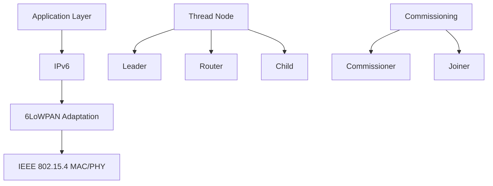
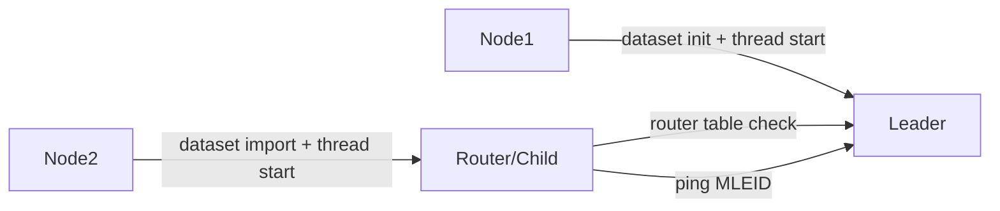
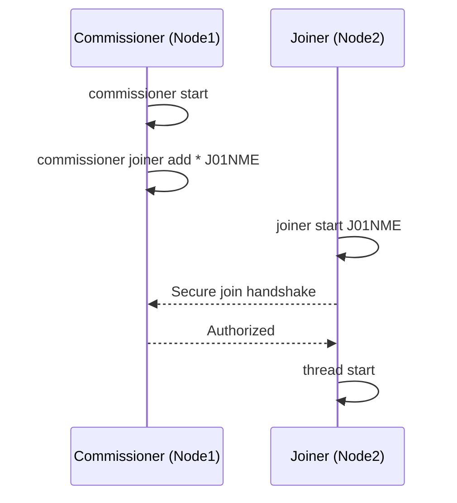
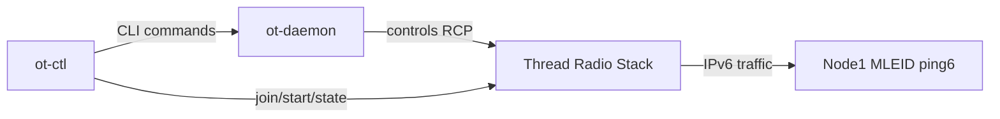
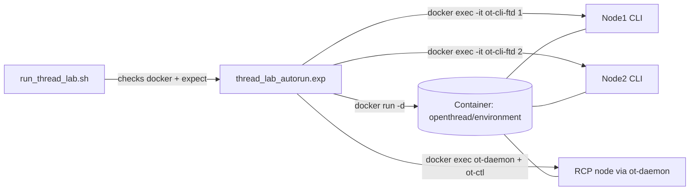
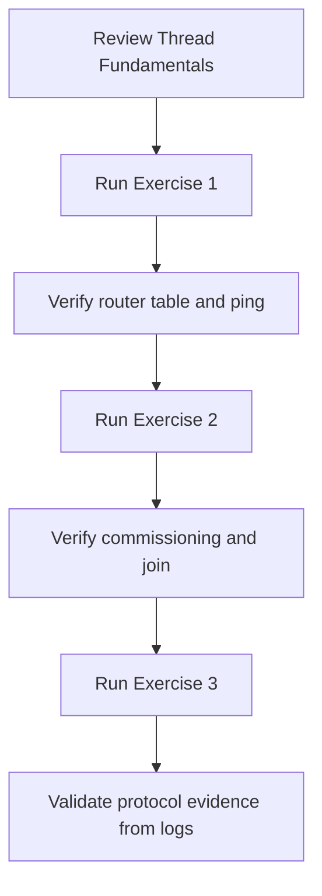

# OpenThread Thread Lab

This repository provides a reproducible OpenThread lab with automated validation and clear protocol context.

It includes:
- a complete automated lab runner (`run_thread_lab.sh` + `thread_lab_autorun.exp`)
- a step-by-step workflow aligned with typical Thread learning goals
- practical checkpoints to verify network formation, commissioning, and IPv6 connectivity

---

## 1) Objectives

By the end of this lab, you should be able to:
- explain what Thread is and why it is used in low-power IoT networks
- identify Thread roles (`leader`, `router`, `child`, Commissioner, Joiner)
- create a basic Thread network and verify node attachment
- perform commissioning and understand secure node admission
- use `ot-daemon` and `ot-ctl` for RCP/NCP-style management
- validate IPv6 connectivity in a Thread network

---

## 2) Thread Protocol Theory

### 2.1 What Thread Is

Thread is an IPv6-based mesh networking protocol built for low-power and low-data-rate IoT devices.  
It runs over IEEE 802.15.4 and uses 6LoWPAN adaptation so constrained devices can communicate with IPv6 networks.

### 2.2 Why Thread Matters

- **Low power**: suitable for battery-powered devices
- **Mesh topology**: multi-hop routing improves coverage and resilience
- **Self-healing**: routes can be recalculated when topology changes
- **IP-native**: devices are addressable with IPv6, easing cloud/home integration
- **Secure commissioning**: explicit procedure to authorize new devices

### 2.3 Main Roles in This Lab

- **Leader**: coordinates network parameters and router table management
- **Router**: forwards traffic and extends mesh connectivity
- **Child**: attached node (often lower-duty operation than router)
- **Commissioner**: authorizes Joiners into the network
- **Joiner**: device requesting secure admission

### 2.4 Addressing Concepts You Will See

- **Mesh-Local IPv6**: Thread-internal addressing domain
- **ML-EID / MLEID**: endpoint identifier used for end-to-end connectivity tests
- **RLOC16**: short routing locator visible in router tables

### 2.5 Visual Model (Mermaid)



This diagram connects protocol stack layers with runtime node roles.

---

## 2.6 Thread in Simple Words

A simple explanation:

- A Thread network is like a **team of smart devices** that can pass messages to each other.
- One device becomes **Leader** (organizes the team).
- Some devices become **Router** (help carry messages).
- Some devices stay **Child** (connected, but less routing work).
- New devices cannot enter directly: they must be approved by a **Commissioner**.
- The new device asks permission as **Joiner**.
- Once approved, the Joiner becomes part of the network and can communicate with IPv6.

Practical analogy:
- Leader = coordinator
- Routers = relays
- Child = attached node with reduced routing responsibility
- Commissioner = admission authority
- Joiner = requesting node

---

## 3) Lab Structure

The automated flow runs three exercises:

### Exercise 1 - Build and Validate a 2-Node Thread Network

What happens:
- Node1 initializes dataset, starts Thread, becomes `leader`
- Node2 imports key/panid, starts Thread, attaches as `child/router`
- Router table is checked
- Node2 pings Node1 MLEID
- Failover behavior is observed after stopping Thread on Node1

Interpretation:
- `child` vs `router` transition timing
- why ping works even as topology evolves
- meaning of `RLOC16` and router table entries



### Exercise 2 - Commissioning (Commissioner + Joiner)

What happens:
- Node1 starts a new network and becomes Commissioner
- Node2 joins using Joiner PSKd (`J01NME`)
- Join success is verified
- Node2 is validated as attached (`child` or `router`)

Interpretation:
- security purpose of commissioning
- difference between open attachment and authorized join



### Exercise 3 - `ot-daemon` + `ot-ctl` (RCP-style workflow)

What happens:
- Node1 forms another network
- `ot-daemon` is started for RCP workflow
- `ot-ctl` is used to join and start Thread
- state is validated (`router`/`child`, with fallback logic)
- IPv6 `ping6` connectivity is verified from shell
- optional `tcpdump` check is attempted when available

Interpretation:
- CLI-on-node vs daemon+control-client management model
- operational troubleshooting when node state remains `detached`



---

## 3.1 Step-by-Step Lab Walkthrough

This section provides the operational sequence and expected evidence.

### Step 0 - Start the automation

Run:

```bash
./run_thread_lab.sh
```

Expected result:
- Docker container is prepared
- all lab commands are executed automatically
- logs are checkpoints, not random text

### Step 1 - Build first Thread network

What happens:
- Node1 creates dataset and starts Thread
- Node1 becomes `leader`
- Node2 receives same network parameters and starts Thread

Expected output evidence:
- `Node1 is leader`
- `Node2 is router` (or first `child`, then `router`)

### Step 2 - Verify communication

What happens:
- script checks router table
- Node2 pings Node1 MLEID

Expected output evidence:
- `Router table contains Node2 RLOC16`
- `Ping Node2->Node1 succeeded`

Why this matters:
- "network formed" is not enough, we also need packet-level proof

### Step 3 - Commissioning

What happens:
- Node1 starts Commissioner role
- Node2 starts Joiner with PSKd `J01NME`
- Join is validated

Expected output evidence:
- `Join success`
- `Node2 joined and is child` or `Node2 joined and is router`

Why this matters:
- secure admission is a core Thread feature

### Step 4 - Daemon-based control (`ot-daemon` + `ot-ctl`)

What happens:
- Node1 forms another network
- RCP path is started via `ot-daemon`
- control is done using `ot-ctl`

Expected output evidence:
- `Spawning ot-daemon (RCP)`
- `Spawning ot-ctl (Terminal C)`

Why this matters:
- this is closer to real gateway/controller deployments

### Step 5 - Final connectivity checks

What happens:
- `ping6` is executed toward Node1 MLEID
- optional `tcpdump` check is executed if available

Expected output evidence:
- `ping6 success: 0% packet loss`
- optional `tcpdump captured traffic`

### Step 6 - End condition

Successful run ends with:
- `AUTORUN COMPLETED SUCCESSFULLY`
- `Thread lab autorun finished.`

---

## 4) Repository Contents

- `run_thread_lab.sh`: entrypoint and preflight checks
- `thread_lab_autorun.exp`: full Expect automation script
- `lab - OpenThread.pdf`: supporting slide deck
- `.gitignore`: ignores OS files, logs and captures

---

## 5) Prerequisites

- macOS or Linux
- Docker Desktop / Docker Engine running
- `expect` installed
  - macOS: `brew install expect`

Tested versions: none; the lab was **not run in this environment** (see Verification status). Expected tooling: Docker Engine/Desktop 20.10+, `expect` 5.45+ (Tcl 8.6), Bash 3.2+ (macOS default is fine), network access to Docker Hub. The container image `openthread/environment:latest` is unpinned, so behaviour can change when it is updated; pin a tag or digest through `IMAGE_NAME` for reproducible runs.

Optional (for extra packet capture check):
- `tcpdump` available in container image (if missing, check is skipped)

---

## 6) Quick Start

From this folder:

```bash
chmod +x run_thread_lab.sh thread_lab_autorun.exp
./run_thread_lab.sh
```

The script will:
- validate Docker daemon health
- pull/update `openthread/environment:latest`
- recreate `codelab_otsim_ctnr` for a clean run
- execute all lab exercises automatically with checkpoints

---

## 7) Optional Configuration

Environment variables:
- `CONTAINER_NAME` (default: `codelab_otsim_ctnr`)
- `IMAGE_NAME` (default: `openthread/environment:latest`)

Example:

```bash
CONTAINER_NAME=my_thread_lab IMAGE_NAME=openthread/environment:latest ./run_thread_lab.sh
```

---

### Architecture of the automation



The Expect script drives each CLI by sending commands and matching output with regular expressions (network key = 32 hex chars, PAN ID = `0x` + 4 hex chars, ML-EID = address starting with `fd`). Binaries are taken from the image under `/openthread/build/...`.

## 7.1) Verification status

| Item | Status |
|------|--------|
| `bash -n run_thread_lab.sh` | verified |
| Tcl syntax of `thread_lab_autorun.exp` is complete (`info complete` with `tclsh`) | verified |
| Full run (Docker image pull, OpenThread simulation, commissioning, `ot-daemon`, `ping6`, `tcpdump`) | not verified in this environment (no `expect`, no OpenThread image) |

## 7.2) Limitations and security

- The script **force-removes** any container named `CONTAINER_NAME` (`docker rm -f`) before starting. Keep the default name or choose one that is not used by other work.
- The container is started with `--cap-add=net_admin` and creates `/dev/net/tun`; it does not use `--privileged`. Do not run it on a host where this is not acceptable.
- Network key, PAN ID and the joiner PSKd `J01NME` are throw-away lab values generated/used inside a disposable container; do not reuse `J01NME` on real devices.
- Timeouts are fixed (e.g. 130 s waiting for `router`); slow machines may fail spuriously.
- The Exercise 1 failover check is intentionally lightweight: it accepts `router` as well as `leader`.
- The final `ping6` check passes only if the packet-loss summary is 0%; partial loss prints a warning, 100% loss fails the run.

## 7.3) Extending the lab

- Add a node: copy the Node2 block in `thread_lab_autorun.exp` (`ot-cli-ftd 3`), set the same `networkkey` and `panid`.
- Change the joiner credential: replace `J01NME` consistently in `start_commissioner_and_allow_wildcard`, `joiner_start_wait_success` and Exercise 3.
- Add checkpoints: use `send_cmd_and_expect` and `verify_state_exact` helpers.

## 8) How to Read Output

During execution, focus on these markers:

- `Node1 is leader`
- `Node2 is router` or `Node2 is child`
- `Router table contains Node2 RLOC16`
- `Ping Node2->Node1 succeeded`
- `Join success`
- `ping6 success: 0% packet loss`
- `AUTORUN COMPLETED SUCCESSFULLY`

Important interpretation:
- In real timing conditions, nodes may stabilize as `child` before `router`
- Some checks intentionally accept both `child` and `router` states

---

## 9) Success Criteria

A successful end-to-end run includes:
- `THREAD-LAB: AUTORUN COMPLETED SUCCESSFULLY`
- `Thread lab autorun finished.`
- process exit code `0`

---

## 10) Troubleshooting

### Docker not reachable

```bash
docker version
df -h
```

If Docker is unhealthy, restart Docker and rerun:

```bash
./run_thread_lab.sh
```

### `expect` missing

```bash
brew install expect
./run_thread_lab.sh
```

### `Timeout waiting` / `Node2 did not reach router state in time`

The machine may be slow or the image changed. Re-run; if it persists, run the commands manually in `docker exec -it codelab_otsim_ctnr /openthread/build/examples/apps/cli/ot-cli-ftd 1`.

### `ping6 failed` in Exercise 3

Check that IPv6 is enabled in Docker (the script sets `net.ipv6.conf.all.disable_ipv6=0`) and that `/dev/net/tun` exists in the container.

### Fresh cleanup

The automation recreates the container each run, but manual cleanup is possible:

```bash
docker rm -f codelab_otsim_ctnr 2>/dev/null || true
```

---

## 11) Suggested Execution Flow

1. Review protocol fundamentals (roles, addressing, commissioning)
2. Run Exercise 1 and verify topology + ping evidence
3. Run Exercise 2 and verify secure onboarding
4. Run Exercise 3 and compare `ot-cli` vs `ot-daemon`/`ot-ctl`
5. Map each checkpoint to the protocol behavior it validates



